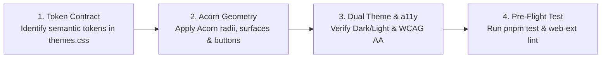

# Acorn UI/UX Skill

Repository-level skill governing UI, visual styling, design tokens, and component architecture for FoxLaunch. Enforces strict compliance with Firefox's official **Acorn Design System** (Nova Refresh) while preserving FoxLaunch's signature brand identity.

---

## Core Principles

1. **3-Tier Token Isolation:**
   - **Layer 1:** `src/styles/tokens/acorn.css` (Acorn Substrate) and `src/styles/tokens/brand.css` (Brand Soul).
   - **Layer 2:** `src/styles/themes.css` (Semantic Adapter).
   - **Layer 3:** Component styles (`swimlane.css`, `modal.css`, `main.css`, `onboarding.css`).
2. **Substrate vs. Soul Balance:**
   - Acorn rules the structure (geometry, neutral surfaces, elevation, layout, focus outlines).
   - Brand rules the expression (Ensō flame mark, flame gradients, signature orange accents).
3. **Zero Hardcoded Values:**
   - Never use raw `#hex`, `rgb()`, or arbitrary `px` values in component CSS files. Always consume semantic variables (`var(--bg-surface)`, `var(--radius-card)`).
4. **Offline & Strict CSP:**
   - Zero external font downloads or network stylesheets. Only native system font stacks (`var(--font-sans)`).
5. **Accessibility Gate (WCAG 2.1 AA):**
   - Minimum 4.5:1 text contrast ratio across both Light and Dark themes.
   - High-visibility 2px focus ring with 2px offset on all interactive elements.

---

## The 4-Step UI Development Workflow

When modifying or adding UI features:



### Step 1: Token Contract Selection
- Before writing CSS, consult `docs/design-system.md` or `.agents/skills/acorn-ui/references/token-catalog.md`.
- Choose the appropriate semantic variable:
  - Surface: `--bg-primary` (canvas), `--bg-secondary` (cards/swimlanes), `--bg-surface-hover` (hover).
  - Radii: `--radius-card` (10px), `--radius-swimlane` (14px), `--radius-dialog` (18px), `--radius-pill` (9999px).
  - Spacing: `--space-1` (4px) through `--space-10` (40px).

### Step 2: Component Pattern Adherence
- **Cards & Swimlanes:** Hairline subtle border, soft corner radius, smooth hover lift (`translateY(-1px)`).
- **Buttons:**
  - Primary button: `--fx-orange` background, rounded button radius, active press scale (`0.98`).
  - Secondary button: Neutral surface with subtle border.
  - Icon button: 36×36px square with rounded button radius.
- **Modals:** 18px radius, frosted glass backdrop (`backdrop-filter: blur(8px)` with fallback), structured header/footer.
- **Search:** Pill-shaped search bar (`--radius-search`) matching Firefox address bar geometry.

### Step 3: Dual Theme & Accessibility Verification
- Check both Dark Mode (`@media (prefers-color-scheme: dark)` / `[data-theme="dark"]`) and Light Mode (`@media (prefers-color-scheme: light)` / `[data-theme="light"]`).
- Verify focus rings are clearly visible on keyboard navigation (`:focus-visible`).
- Confirm text contrast exceeds 4.5:1.

### Step 4: Pre-Flight Quality Check
Always execute before finishing:
```powershell
pnpm run typecheck
pnpm run build
pnpm run lint:ext
pnpm run test:e2e
```

---

## Upstream Acorn Synchronization SOP

If Mozilla releases an Acorn or Firefox design refresh:
1. Inspect upstream changes in Mozilla release notes or `toolkit/themes/shared/design-system/src/tokens/`.
2. Edit **only** `src/styles/tokens/acorn.css`.
3. Check `src/styles/themes.css` only if Mozilla introduced brand-new token roles.
4. Run `pnpm test` to verify regressions.
