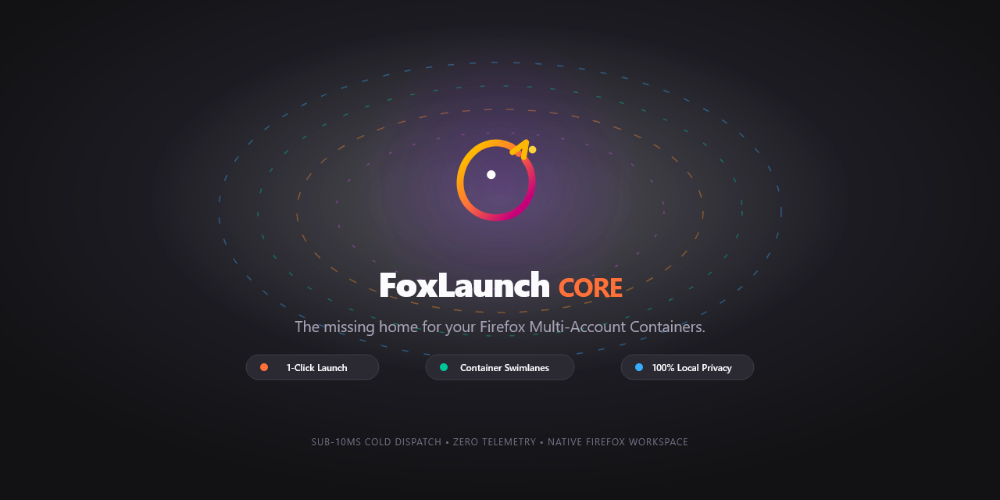

# FoxLaunch 🦊🚀

> A container-aware, privacy-first Firefox New Tab workspace launchpad (Manifest V3).


[](https://addons.mozilla.org/en-US/firefox/addon/foxlaunch/)

Install [FoxLaunch on Mozilla Add-ons](https://addons.mozilla.org/en-US/firefox/addon/foxlaunch/).



FoxLaunch organizes your shortcuts into dedicated **Firefox Multi-Account Container** swimlanes and dispatches tabs directly into their isolated container contexts with a single click. It runs locally, with no tracking, telemetry, or remote CDN assets.

---

## ✨ Features

- 🗂️ **Container-Aware Swimlanes**: Automatically discovers your Firefox Multi-Account Containers (`browser.contextualIdentities`), rendering collapsible swimlanes styled with native Firefox container color accents and icons.
- ↕️ **Reorderable Swimlanes**: Drag swimlanes or use the keyboard reorder controls to arrange containers in your preferred order.
- ⚡ **1-Click Container Dispatch**: Launches shortcuts directly inside their assigned container profile (`browser.tabs.create({ cookieStoreId })`).
  - **Foreground Launch**: Left-click opens foreground tab (optionally auto-closing the launcher tab).
  - **Background Launch**: Middle-click or `Ctrl`/`Cmd` + Left-Click opens in the background without closing the launcher.
- 🔍 **Instant Search & Filter**: Press `/` from anywhere on the page to focus the search bar and filter shortcuts across all swimlanes in real time.
- ✏️ **In-Page Shortcut CRUD**:
  - Add and edit shortcuts with container assignment and URL validation (`https://`, `http://`, `about:`).
  - Drag-and-drop intra-swimlane reordering.
  - Delete with a 5-second countdown **Undo Toast**.
- 🎨 **Local Favicons & Offline Procedural Avatars**: Captured site favicons are saved as local image data and displayed without loading remote images in the launcher. If no favicon is available, a letter avatar is generated locally as an SVG data URI with WCAG AA luminance contrast.
- ⚙️ **Customizable Settings**:
  - Launcher tab behavior: `Keep launcher tab open` or `Close launcher tab on launch`.
  - Theme mode: `System Default`, `Dark`, or `Light`.
  - Card size: `Small`, `Medium` (default), or `Large`, applied instantly across all swimlanes and saved locally.
  - Container swimlane visibility: **Show all** (default), **Only show these**, or **Hide these**. Select containers and/or enter name patterns, one per line (e.g. `Work*`, `Dev-*`). Patterns match whole names case-insensitively; `*` matches any text and other characters are literal. Empty filters show no containers in “Only show these” and hide none in “Hide these”. The default context always remains visible. Filters save locally, apply to newly discovered containers, and never delete hidden shortcuts.
  - Factory reset with two-stage confirmation.
- 🚶 **First-Run Onboarding**: Guided 4-step walkthrough overlay for new users with keyboard navigation and step indicators.
- 🔒 **Privacy & Strict CSP**: Manifest V3 compliant (`script-src 'self'`), with no telemetry, analytics, remote scripts, or `innerHTML` usage.
- ♿ **Accessible**: WCAG 2.1 AA keyboard navigation, modal focus traps, and Escape-key dismissal.

### Keyboard shortcuts

| Key or action | Result |
| --- | --- |
| `/` | Focus and select the search field |
| `Esc` | Clear and leave search, or dismiss the active modal/menu |
| `Tab` / `Shift+Tab` | Navigate controls; focus stays within an open modal |
| `Enter` | Open the focused shortcut in a foreground tab |
| Middle-click or `Ctrl`/`Cmd` + click | Open the shortcut in a background tab |

### Firefox requirements and permissions

FoxLaunch requires Firefox 142 or newer. For the most container-aware experience, install [Firefox Multi-Account Containers](https://addons.mozilla.org/en-US/firefox/addon/multi-account-containers/) or configure containers in Firefox.

| Permission | Why FoxLaunch requests it |
| --- | --- |
| `contextualIdentities` | Discover container names, colors, and icons so shortcuts can be organized in the matching swimlanes. |
| `cookies` | Firefox's container APIs use cookie stores to isolate contexts; FoxLaunch addresses those stores by ID and does not read individual cookie values. |
| `storage` | Save shortcuts, locally cached favicons, and preferences on your device. |
| `tabs` | Open shortcuts in the selected container and capture favicons from matching browser tabs. |

## Contributing

Contributions are welcome! Start with the [contributor guide](CONTRIBUTING.md) for development setup, architecture, and pull request guidance. Use [Conventional Commits v1.0.0](https://www.conventionalcommits.org/en/v1.0.0/); submit routine pull requests to `main`. The `release` branch is reserved for maintainer-led releases.

Before submitting a pull request, run:

```bash
pnpm run typecheck
pnpm run build
pnpm run lint:ext
pnpm run test:e2e
```

## Changelog

See [CHANGELOG.md](CHANGELOG.md) for version history. FoxLaunch follows [Semantic Versioning](https://semver.org/spec/v2.0.0.html) and [Keep a Changelog](https://keepachangelog.com/en/1.1.0/) principles.

---

## 🛠️ Architecture & Tech Stack

- **Language & Runtime**: TypeScript 5.8+ (Strict Mode), Vanilla DOM (no frontend framework runtime)
- **Bundler & Build Tool**: Vite 6
- **Extension Platform**: WebExtensions Manifest V3 (`chrome_url_overrides.newtab`)
- **Testing**: Playwright for Desktop Firefox (140 E2E tests across 9 suites), Node test runner (40 unit tests)
- **Linter**: Mozilla `web-ext lint` (0 errors, 0 warnings, 0 notices)

---

## 🚀 Getting Started

### Prerequisites

- [Node.js](https://nodejs.org/) (v20+)
- [pnpm](https://pnpm.io/) (v9+)
- [Mozilla Firefox](https://www.mozilla.org/firefox/)

### Installation

```bash
# Clone the repository
git clone https://github.com/melkorCBA/fox-launch.git
cd fox-launch

# Install dependencies
pnpm install
```

### Development

```bash
# Start Vite development server
pnpm run dev
```

### Build & Validate

```bash
# Typecheck TypeScript source
pnpm run typecheck

# Build production bundle to dist/
pnpm run build

# Run Mozilla WebExtension linter
pnpm run lint:ext

# Run automated Playwright test suite in Desktop Firefox
pnpm run test:e2e
```

---

## 🧩 Loading into Firefox

1. Build the production extension:
   ```bash
   pnpm run build
   ```
2. Open Firefox and navigate to `about:debugging#/runtime/this-firefox`.
3. Click **"Load Temporary Add-on..."**.
4. Navigate to the project root and select `dist/manifest.json`.
5. Open a new tab (`Ctrl+T` or `Cmd+T`) to use FoxLaunch!

---

## 📦 GitHub Packages

Production extension builds are published to [GitHub Packages](https://github.com/melkorCBA/fox-launch/packages).

### Installing the Package

GitHub Packages requires registry authentication even for public packages:

1. Generate a GitHub [Personal Access Token (classic)](https://github.com/settings/tokens) with the `read:packages` scope.
2. Configure your local or project `.npmrc` (do not commit your token):

```ini
@melkorcba:registry=https://npm.pkg.github.com
//npm.pkg.github.com/:_authToken=${GITHUB_TOKEN}
```

3. Export your token in your environment:
```bash
export GITHUB_TOKEN=ghp_yourTokenHere
```

4. Install the package:
```bash
npm install @melkorcba/fox-launch
# or
pnpm add @melkorcba/fox-launch
```
The package contains the production `dist/` extension bundle, `manifest.json`, and pre-packaged `.zip` archives.

---

## 📄 License

This project is licensed under the [MIT License](LICENSE).
