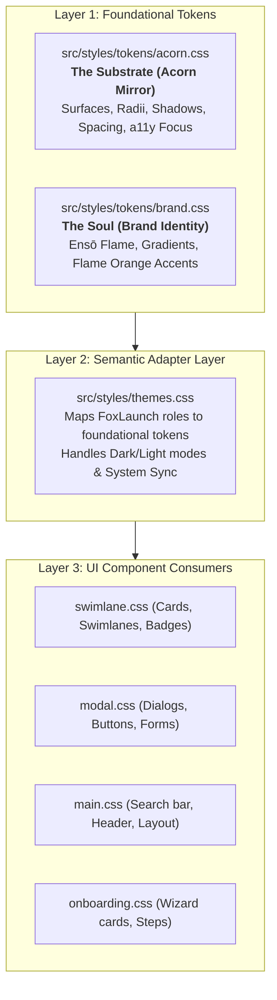
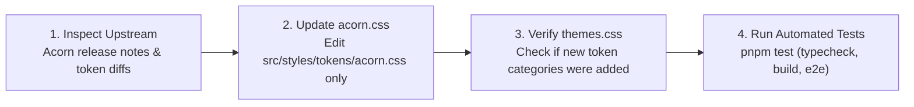

# FoxLaunch — Design System Specification & Architecture

> **Master Specification:** Firefox Acorn Design System (Nova Refresh 2026 / Firefox 157+)  
> **Brand Stance:** FoxLaunch Core (Official-Tier Firefox Purist)  
> **Status:** Production Specification  

---

## 1. Architectural Strategy: The 3-Tier Adapter Pattern

FoxLaunch is engineered to live inside Firefox's New Tab page. To ensure long-term ecosystem integrity and make future Firefox design updates effortless, the design architecture follows a strict **3-Tier Adapter Pattern**:

### The Separation of Concerns
1. **Layer 1: Foundational Tokens (`src/styles/tokens/`)**
   - **`acorn.css` (The Substrate):** Pure 1:1 vendor mirror of Mozilla's Acorn design tokens. Contains zero FoxLaunch-specific selectors or overrides.
   - **`brand.css` (The Soul):** FoxLaunch's proprietary brand identity tokens (Ensō Flame Mark, flame gradient, and signature accents).
2. **Layer 2: Semantic Adapter Layer (`src/styles/themes.css`)**
   - The contract between upstream design foundations and the application.
   - Maps functional roles (`--surface-canvas`, `--surface-card`, `--radius-card`, `--radius-dialog`, `--radius-pill`) to foundational tokens.
   - Manages Light, Dark, and High Contrast system adaptations.
3. **Layer 3: Component Styles (`src/styles/*.css`)**
   - Reusable UI elements (`.swimlane`, `.shortcut-card`, `.modal-dialog`, `.btn-primary`, `.search-input`).
   - Components **only** consume Layer 2 semantic variables. They never hardcode `#hex` values or arbitrary pixel radii.

---

## 2. The "Substrate vs. Soul" Model

A critical principle of FoxLaunch is balancing **native browser belonging** with **distinct product character**:

> **"The Design System rules the structure; the Brand Identity rules the expression."**

| Dimension | Acorn Design System (The Substrate) | FoxLaunch Brand Identity (The Soul) |
|---|---|---|
| **Role** | Native browser chassis, grammar, and layout | Personality, visual focal points, and purpose |
| **Colors** | Neutral surface tiers (Obsidian `#1C1B22`, Crisp `#F9F9FB`), focus rings | Signature Flame Gradient (`#FFB800` &rarr; `#FF7139` &rarr; `#C6007A`), Flame Orange (`#FF7139`) |
| **Geometry** | Softer pill and squircle radii (6px, 10px, 14px, 18px, 9999px) | Curled Ensō Flame Fox mark, squircle app icon |
| **Surfaces** | Multi-layered neutral hierarchy, frosted blur dialog backdrops | Tactical high-contrast card lifts on hover |
| **Microcopy** | Clean, concise, platform-standard labels | Firefox purist terminology (*"Container Swimlanes"*, *"1-Click Launch"*, *"Instant Filter"*) |

---

## 3. Upstream Acorn Synchronization SOP

When Mozilla announces future updates to Firefox's Acorn design system, follow this Standard Operating Procedure:

1. **Step 1: Inspect Upstream Changes**
   - Review Mozilla Add-ons Blog posts, Acorn token updates (`toolkit/themes/shared/design-system/src/tokens/`), or `acorn.firefox.com`.
2. **Step 2: Update Foundation Tokens in `tokens/acorn.css`**
   - Modify the token values (e.g. corner radii, surface colors, or elevation shadows) directly in `src/styles/tokens/acorn.css`.
3. **Step 3: Check Adapter in `themes.css`**
   - If Mozilla introduced new semantic roles, update the mapping in `src/styles/themes.css`. If existing token values simply shifted, no changes to `themes.css` or component files are required.
4. **Step 4: Run Automated Verification**
   - Execute `pnpm test` (verifies TypeScript compilation, Vite build, `web-ext lint`, and Playwright end-to-end tests).

---

## 4. Token Mapping Dictionary

### 4.1 Neutral Surface Tiers

| Semantic Variable | Acorn Dark Token | Acorn Light Token | Purpose |
|---|---|---|---|
| `--bg-primary` | `#1C1B22` (`--acorn-surface-canvas`) | `#F9F9FB` (`--acorn-surface-canvas`) | Base New Tab canvas |
| `--bg-secondary` | `#2B2A33` (`--acorn-surface-layer-1`) | `#FFFFFF` (`--acorn-surface-layer-1`) | Swimlane container & card base |
| `--bg-tertiary` | `#201F27` (`--acorn-surface-layer-3`) | `#F0F0F4` (`--acorn-surface-layer-3`) | Counter chips, secondary buttons |
| `--bg-surface-hover` | `#383742` (`--acorn-surface-layer-2`) | `#F0F0F4` (`--acorn-surface-layer-2`) | Shortcut card hover state |
| `--bg-overlay` | `rgba(28, 27, 34, 0.85)` | `rgba(0, 0, 0, 0.45)` | Frosted glass backdrop |

### 4.2 Geometry & Corner Radii

| Semantic Variable | Acorn Token | Value | Target Components |
|---|---|---|---|
| `--radius-sm` | `--acorn-radius-sm` | `6px` | Favicons, keycap chips |
| `--radius-card` | `--acorn-radius-md` | `10px` | Shortcut cards, menus, toasts |
| `--radius-swimlane` | `--acorn-radius-lg` | `14px` | Container swimlanes |
| `--radius-dialog` | `--acorn-radius-xl` | `18px` | Settings modal, Add shortcut modal |
| `--radius-pill` | `--acorn-radius-pill` | `9999px` | Search bar, container badges, buttons |

### 4.3 Interactive Controls & Elevation

| Semantic Variable | Foundation Source | Value / Mapping | Target Components |
|---|---|---|---|
| `--btn-primary-bg` | Brand Foundation | `var(--fx-orange)` (`#FF7139`) | Primary CTA buttons |
| `--btn-primary-hover`| Brand Foundation | `var(--fx-orange-hover)` (`#E05620`) | Primary button hover |
| `--border-focus` | Acorn Foundation | `#37adff` (Dark) / `#0060df` (Light) | 2px focus ring with 2px offset |
| `--shadow-sm` | Acorn Foundation | `--acorn-elevation-1` | Idle swimlane & search bar |
| `--shadow-md` | Acorn Foundation | `--acorn-elevation-2` | Shortcut card hover state |
| `--shadow-modal` | Acorn Foundation | `--acorn-elevation-modal` | Floating modal dialogs |

---

## 5. Contributor & Agent Guardrails

All UI contributions must strictly adhere to the following rules:

1. **Zero Hardcoded Values:** Never use raw `#hex`, `rgb()`, or pixel dimensions directly in component CSS files (`swimlane.css`, `modal.css`, `main.css`). Always reference semantic variables (`var(--bg-surface)`, `var(--radius-card)`).
2. **Strict Offline & Local CSP:** No external web fonts (`@import url(...)`), remote CDNs, or external stylesheet links. Only native system font stacks (`var(--font-sans)`) are permitted to preserve sub-10ms cold render dispatch.
3. **WCAG 2.1 AA Accessibility:** All text and interactive element pairings must maintain a minimum 4.5:1 contrast ratio against their respective surface tiers.
4. **Keyboard-First Navigation:** Every interactive element must present a high-visibility 2px focus ring with 2px offset (`:focus-visible`).
